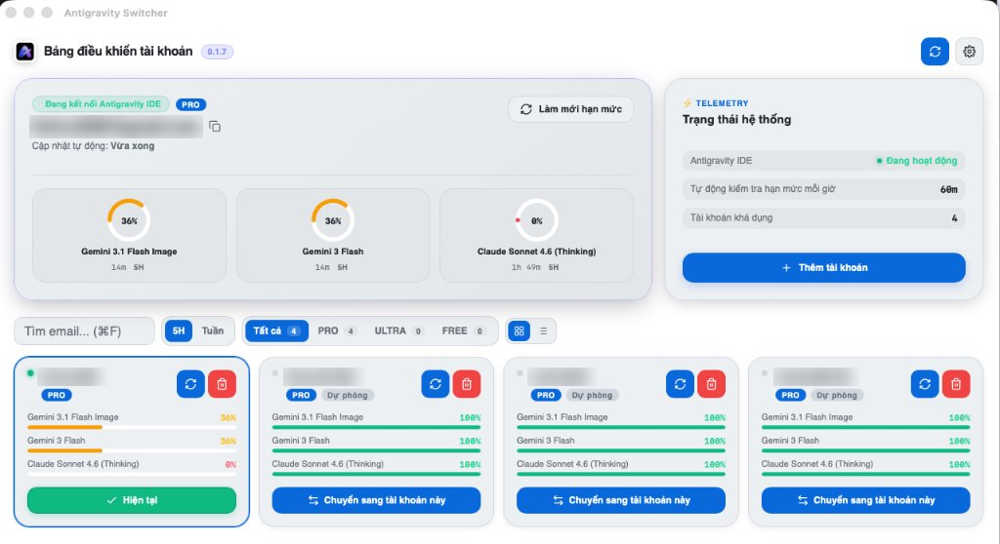

# Antigravity Switcher

Ứng dụng quản lý và chuyển đổi tài khoản Google cho **Antigravity IDE**, theo dõi hạn mức quota theo thời gian thực và tự động phát hiện tình trạng sức khỏe tài khoản. App chạy nền trên thanh menu (Tray): bấm chuột trái để mở Dashboard, bấm chuột phải để chuyển tài khoản nhanh.



Có sẵn bản cài đặt cho **macOS** (DMG) và **Windows** (EXE). Tự động đồng bộ và hoán đổi phiên làm việc trực tiếp với Antigravity IDE (`/Applications/Antigravity IDE.app` trên macOS).

---

## 🌟 Tính năng nổi bật

* **Giao diện Modern Bento Dashboard:**
  * **Thẻ Active Hero:** Hiển thị tài khoản đang kết nối với Antigravity IDE cùng cụm đồng hồ đo hạn mức SVG (`CircularGauge`) trực quan cho từng model (Gemini 3.1 Flash, Gemini 3 Flash, Claude Sonnet 4.6), tự động đổi màu theo % quota còn lại.
  * **Thẻ Telemetry Hệ thống:** Đèn xung hiển thị trạng thái hoạt động của Antigravity IDE, chu kỳ tự động làm mới hạn mức đang chọn và tổng số tài khoản khả dụng.
  * **Chuyển đổi dạng xem:** Hỗ trợ linh hoạt giữa **Dạng lưới thẻ (Grid View)** và **Dạng danh sách gọn (Compact List View)**.
  * **Rút gọn email thông minh:** Tự động tối ưu không gian thẻ dự phòng, hỗ trợ sao chép email 1-chạm.
* **Bộ Giám Sát Sức Khỏe Tài Khoản & Cảnh Báo Hạ Cấp (Health & Tier Monitor):**
  * Tự động phát hiện khi tài khoản bị rớt gói từ **PRO $\to$ FREE** (hết hạn dùng thử, lỗi gia hạn).
  * Phát hiện phiên đăng nhập Google hết hạn (`needs_relogin`).
  * Bắn **Native Desktop Notification**, hiển thị banner cảnh báo trên thẻ và kích hoạt icon chấm đỏ cảnh báo trên khay hệ thống.
* **Đồng bộ ngầm với Antigravity IDE (IDE Account Watcher):**
  * Tiến trình ngầm siêu nhẹ kiểm tra mỗi 15 giây. Khi bạn đổi tài khoản trực tiếp trong Antigravity IDE, Switcher sẽ tự nhận biết, cập nhật giao diện và gửi thông báo hệ thống.
* **Tự động kiểm tra hạn mức định kỳ:**
  * Tự động làm mới hạn mức tài khoản đang dùng. Mặc định mỗi 10 phút, chọn được 10–120 phút theo bước 10, và cảnh báo khi mức quota phiên $\le$ 5%.
* **Hộp thoại Cài đặt chuẩn macOS (2-Column Bento):**
  * Tùy biến ngôn ngữ (**Tiếng Việt** / **English**).
  * Chế độ hiển thị (**Sáng** / **Tối** / **Hệ thống**).
  * Bảng màu cá nhân hóa với **12 Themes** (Tokyo Night, Catppuccin, Nord, Dracula, GitHub, Emerald,...).
  * Kiểm tra cập nhật ứng dụng trực tiếp từ GitHub Releases.

---

## Cài từ file DMG (macOS)

File cài có dạng `Antigravity Switcher_0.1.9_aarch64.dmg` trên máy Apple Silicon, hoặc `Antigravity Switcher_0.1.9_x86_64.dmg` trên máy Intel.

1. Tải và mở file `.dmg`.
2. Kéo **Antigravity Switcher** vào thư mục **Applications**.
3. Tháo đĩa (eject), rồi mở app từ `/Applications`.
4. Lần đầu macOS có thể chặn app chưa công chứng (notarize). Bấm chuột phải vào app, chọn **Open**, rồi xác nhận **Open**.
5. Nếu vẫn bị chặn, vào **System Settings → Privacy & Security** và chọn **Open Anyway**.
6. Hoặc chạy lệnh sau trong Terminal nếu Gatekeeper chặn:

```bash
sudo xattr -rd com.apple.quarantine "/Applications/Antigravity Switcher.app"
```

> **Mẹo:** Khi đóng cửa sổ, app vẫn tiếp tục chạy ngầm trên thanh menu (Menu bar tray). Thoát hẳn app bằng cách bấm chuột phải vào icon tray và chọn **Thoát**.

---

## Cài từ file EXE (Windows)

File cài có dạng `Antigravity Switcher_0.1.9_x64-setup.exe`.

1. Chạy file `setup.exe`.
2. Nếu Windows SmartScreen hiện cảnh báo, chọn **More info** → **Run anyway**.
3. Làm theo trình cài đặt để hoàn tất. App sẽ xuất hiện trong Start Menu và Khay hệ thống (System Tray).

---

## Build từ mã nguồn

Cả hai hệ điều hành dùng chung các bước sau, trong thư mục dự án:

```bash
npm install
```

Trước khi build, app cần client OAuth desktop đang nằm trong Antigravity IDE đã cài. Bạn không cần tạo client này trên Google Cloud. File nhận hai giá trị là `src-tauri/oauth.local` (file này không được commit).

Trên macOS, đứng ở thư mục dự án và chạy script trích xuất:

```bash
python3 - << 'PY'
from pathlib import Path
import re

ide = Path("/Applications/Antigravity IDE.app/Contents/Resources/app/out/main.js")
text = ide.read_text(errors="replace")
start = text.find("oauthClient.js")
if start < 0:
    raise SystemExit("Không thấy oauthClient.js. Hãy cài Antigravity IDE vào /Applications.")
chunk = text[start:start + 2000]
client_ids = re.findall(r"[0-9]+-[A-Za-z0-9_-]+\.apps\.googleusercontent\.com", chunk)
client_secrets = re.findall(r"GOCSPX-[A-Za-z0-9_-]+", chunk)
if not client_ids or not client_secrets:
    raise SystemExit("Không thấy client OAuth trong Antigravity IDE.")
out = Path("src-tauri/oauth.local")
out.write_text(
    f"ANTIGRAVITY_OAUTH_CLIENT_ID={client_ids[0]}\n"
    f"ANTIGRAVITY_OAUTH_CLIENT_SECRET={client_secrets[0]}\n"
)
print(f"Đã ghi {out}. Không commit file này.")
PY
```

Trên Windows, mở PowerShell tại thư mục dự án và chạy:

```powershell
$candidates = @(
  Join-Path $env:LOCALAPPDATA "Programs\Antigravity IDE\resources\app\out\main.js"
  Join-Path $env:ProgramFiles "Antigravity IDE\resources\app\out\main.js"
)
$ide = $candidates | Where-Object { Test-Path $_ } | Select-Object -First 1
if (-not $ide) {
  throw "Không thấy Antigravity IDE. Hãy cài IDE trước."
}
$text = [IO.File]::ReadAllText($ide)
$start = $text.IndexOf("oauthClient.js")
if ($start -lt 0) {
  throw "Không thấy oauthClient.js trong Antigravity IDE."
}
$chunk = $text.Substring($start, [Math]::Min(2000, $text.Length - $start))
$clientId = [regex]::Match($chunk, '[0-9]+-[A-Za-z0-9_-]+\.apps\.googleusercontent\.com').Value
$clientSecret = [regex]::Match($chunk, 'GOCSPX-[A-Za-z0-9_-]+').Value
if (-not $clientId -or -not $clientSecret) {
  throw "Không thấy client OAuth trong Antigravity IDE."
}
New-Item -ItemType Directory -Force -Path "src-tauri" | Out-Null
$out = Join-Path (Get-Location) "src-tauri\oauth.local"
@(
  "ANTIGRAVITY_OAUTH_CLIENT_ID=$clientId"
  "ANTIGRAVITY_OAUTH_CLIENT_SECRET=$clientSecret"
) | Set-Content -Path $out -Encoding ascii
Write-Host "Đã ghi $out. Không commit file này."
```

Sau đó tiến hành build gói ứng dụng:

```bash
npm run tauri build
```

Chạy chế độ phát triển (Development):

```bash
npm run tauri dev
```

---

## Hướng dẫn sử dụng

1. **Thêm tài khoản:** Bấm nút **+ Thêm tài khoản** ở thẻ Telemetry. Google Chrome sẽ tự động mở trang đăng nhập Google OAuth. App không bao giờ yêu cầu mật khẩu của bạn.
2. **Theo dõi hạn mức:** Quota của từng model hiển thị trực tiếp trên vòng đồng hồ SVG ở thẻ Active Hero, kèm thời điểm lấy hạn mức lần cuối. Hạn mức tự động làm mới theo chu kỳ đã chọn hoặc bạn có thể bấm icon ⟳ để làm mới thủ công.
3. **Chuyển đổi tài khoản:** 
   - Bấm nút **Chuyển sang tài khoản này** trên thẻ tài khoản dự phòng mong muốn.
   - Hoặc click chuột phải vào icon ứng dụng trên thanh Menu / Khay hệ thống và chọn tài khoản.
   - Switcher thoát Antigravity và Antigravity IDE nếu đang mở, ghi phiên mới vào Keychain và file phiên của Antigravity, rồi mở lại các app đó.
4. **Bộ lọc & Tìm kiếm:** Sử dụng ô tìm kiếm (`⌘F`) để tra cứu nhanh email hoặc lọc nhanh theo gói cước (`Tất cả`, `PRO`, `ULTRA`, `FREE`).
5. **Cài đặt hệ thống:** Bấm icon bánh răng ⚙ trên thanh tiêu đề để tùy biến ngôn ngữ, chế độ hiển thị Sáng/Tối, 12 bảng màu Bento, bật/tắt tự động kiểm tra hạn mức và chọn chu kỳ 10–120 phút.

---

## Dữ liệu lưu trữ trên máy

| Nội dung | Vị trí |
| --- | --- |
| Danh sách tài khoản | `~/Library/Application Support/Antigravity Switcher` |
| Refresh token của app | macOS Keychain, service `antigravity-switcher` |
| Phiên Antigravity 2.29 | macOS Keychain, service `gemini`, account `antigravity`, và `~/.gemini/jetski-standalone-oauth-token` |
| Phiên Antigravity IDE khi chưa cài Antigravity.app | SQLite `~/Library/Application Support/Antigravity IDE/User/globalStorage/state.vscdb` |
| Cấu hình giao diện, theme | LocalStorage bên trong webview của ứng dụng |

> **Lưu ý bảo mật:** Xóa tài khoản trong Switcher chỉ gỡ tài khoản khỏi danh sách lưu trữ của app. Phiên đang đăng nhập hiện tại trong Antigravity IDE vẫn được giữ nguyên.
